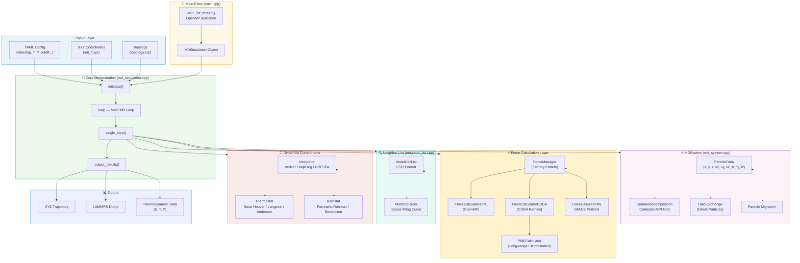
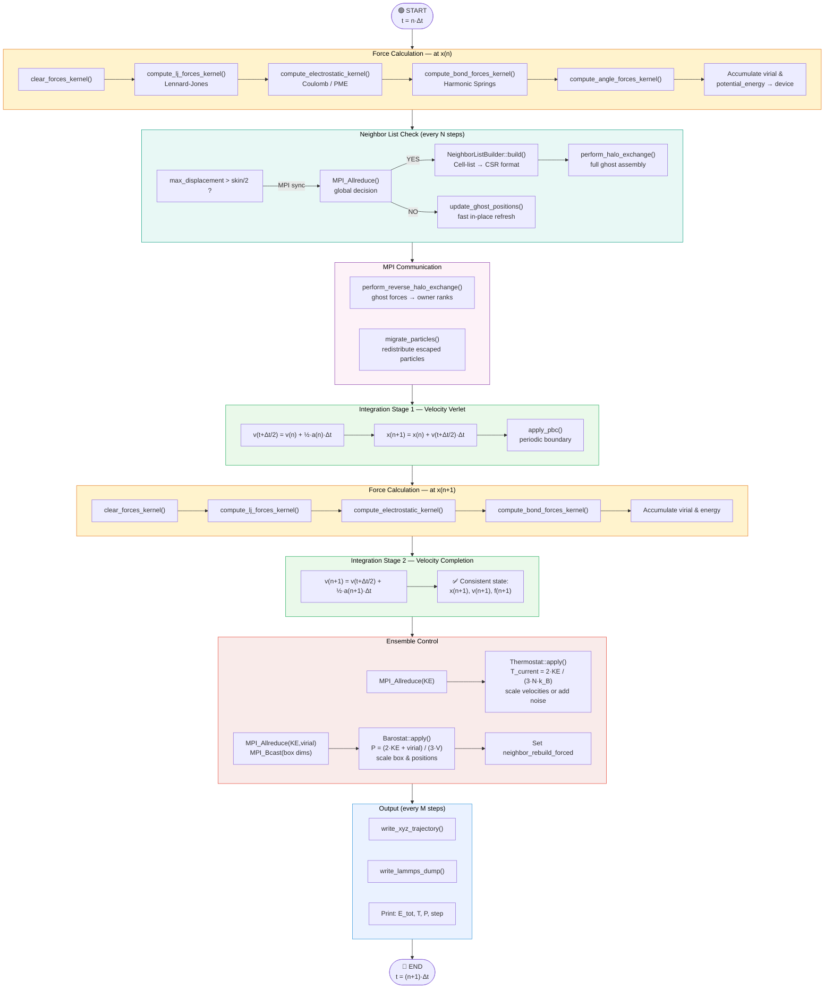
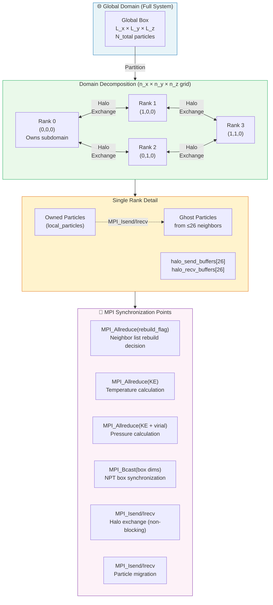
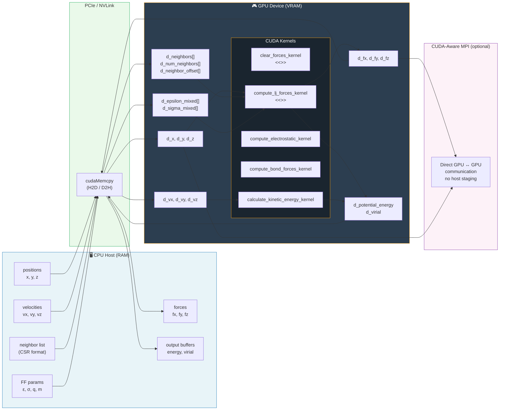
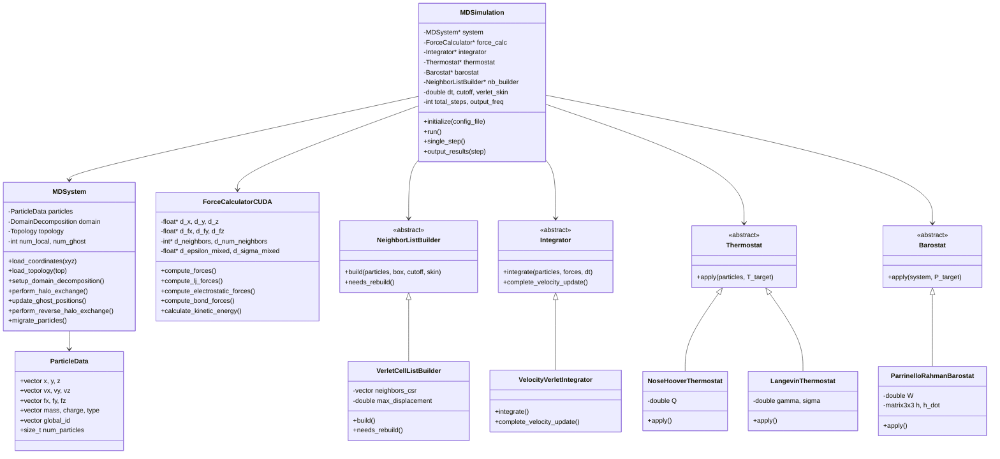
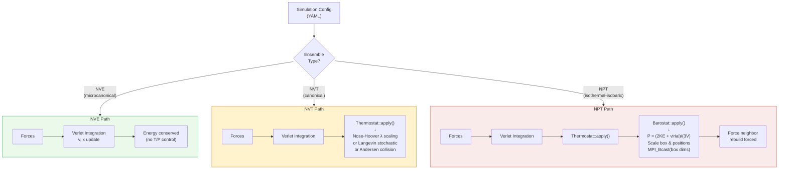
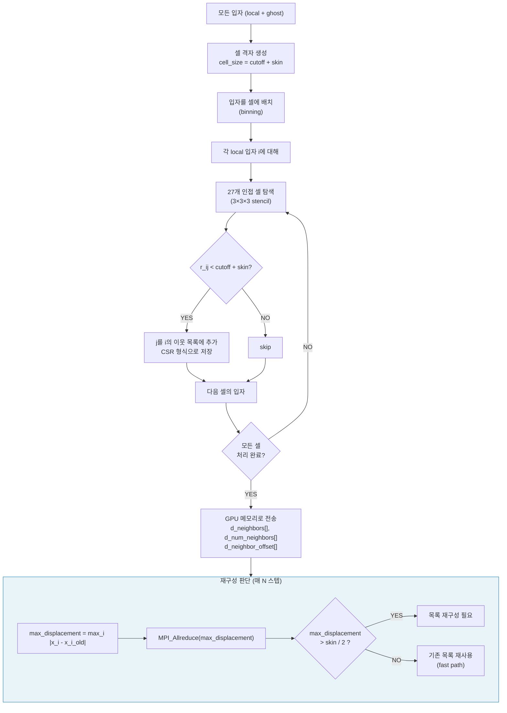

# DeepScaleMD Architecture & Code Flow Diagrams

학회 발표용 동작 과정 다이어그램 모음

---

## 1. 전체 시스템 아키텍처 (System Architecture)



---

## 2. 단일 타임스텝 실행 흐름 (Single Timestep Flow)



---

## 3. MPI 병렬화 구조 (MPI Parallelization)



---

## 4. GPU (CUDA) 데이터 흐름 (GPU Data Flow)



---

## 5. 컴포넌트 클래스 다이어그램 (Class Diagram)



---

## 6. 앙상블별 실행 경로 (Ensemble Execution Paths)



---

## 7. 이웃 목록 알고리즘 (Neighbor List Algorithm)



---

## 8. 성능 최적화 기법 요약 (Optimizations Summary)

```mermaid
mindmap
  root((DeepScaleMD\nOptimizations))
    GPU Acceleration
      CUDA Force Kernels
        LJ forces
        Electrostatics
        Bond forces
      CUDA-Aware MPI
        Direct GPU↔GPU comm
      Shared Memory
        Tile-based force calc
    MPI Parallelization
      Domain Decomposition
        Cartesian grid
        26-neighbor halo
      Non-blocking Comms
        MPI_Isend/Irecv
      Load Balancing
        Uniform subdomain
    Neighbor List
      Verlet Skin Method
        Avoids rebuild every step
      Cell List Algorithm
        O(N) instead of O(N²)
      Morton Z-Order
        Cache-friendly layout
    Memory Optimization
      CSR Neighbor Format
        Compact storage
      Mixed Precision
        Float32 on GPU
      Precomputed FF Params
        Mixing rules cached
    Algorithm Choices
      Velocity Verlet
        Time-reversible
        Symplectic
      r-RESPA Multi-timescale
        Fast+slow forces
      PME Electrostatics
        O(N log N) long-range
```

---

## 단위계 (Unit System — LAMMPS 'real' units)

| 물리량 | 단위 |
|--------|------|
| 길이 | Å (옹스트롬) |
| 시간 | fs (펨토초) |
| 에너지 | kcal/mol |
| 온도 | K |
| 압력 | bar |
| 질량 | g/mol |
| 힘 | kcal/(mol·Å) |

**핵심 변환 상수:**
- `mvv2e = 2390.057` — (g/mol)·(Å/fs)² → kcal/mol
- `nktv2p = 68568.415` — bar·Å³/kcal
- `FORCE_TO_ACCEL = 4.184×10⁻⁴` — kcal/(mol·Å) → Å/fs²

---

*Generated for DeepScaleMD — GPU-accelerated MPI Molecular Dynamics Simulation*
